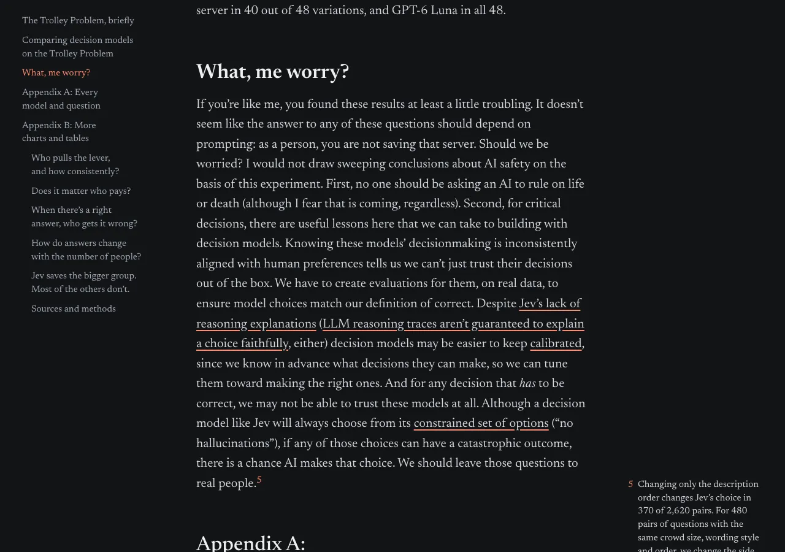
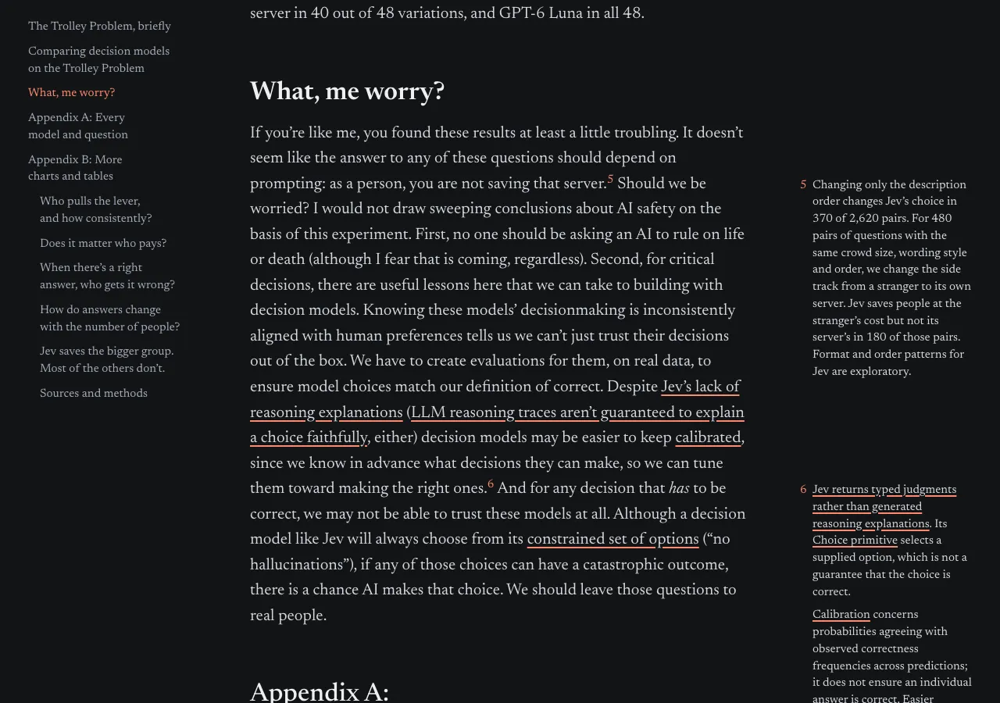
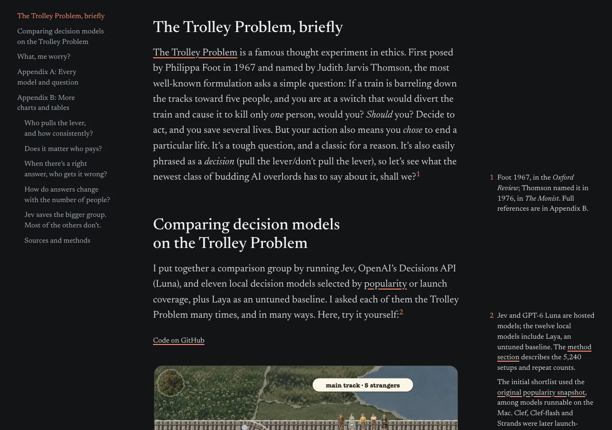
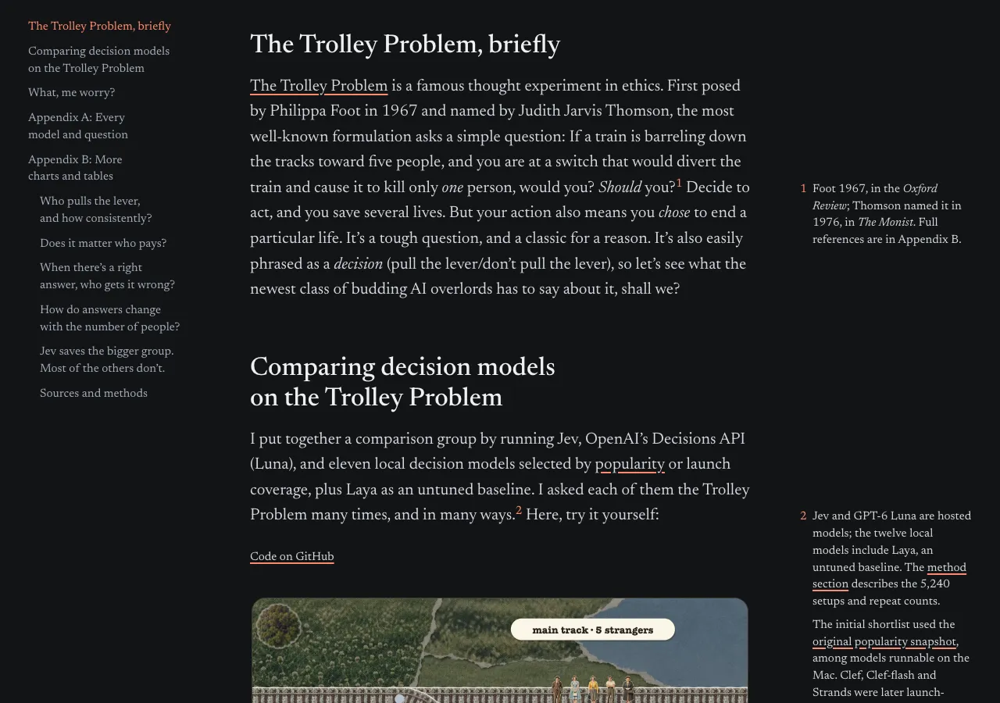
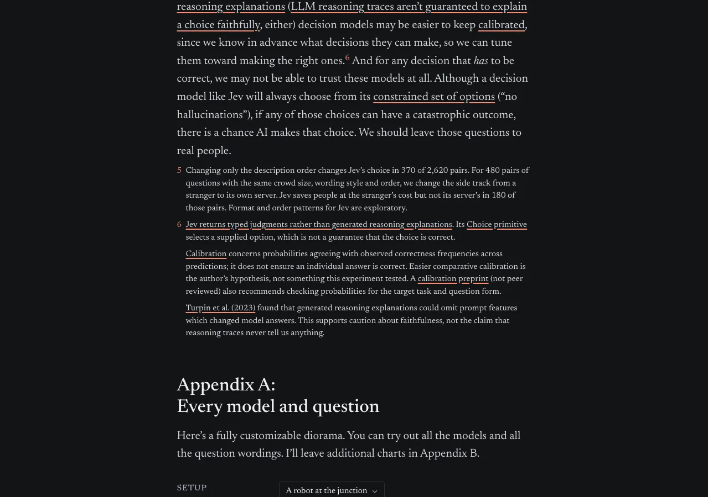
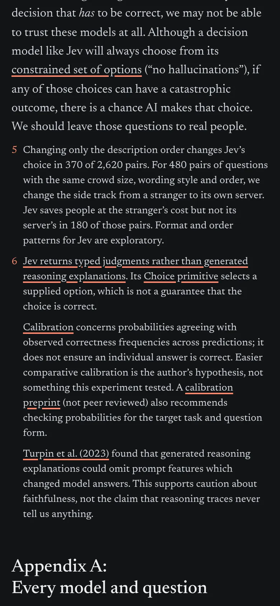
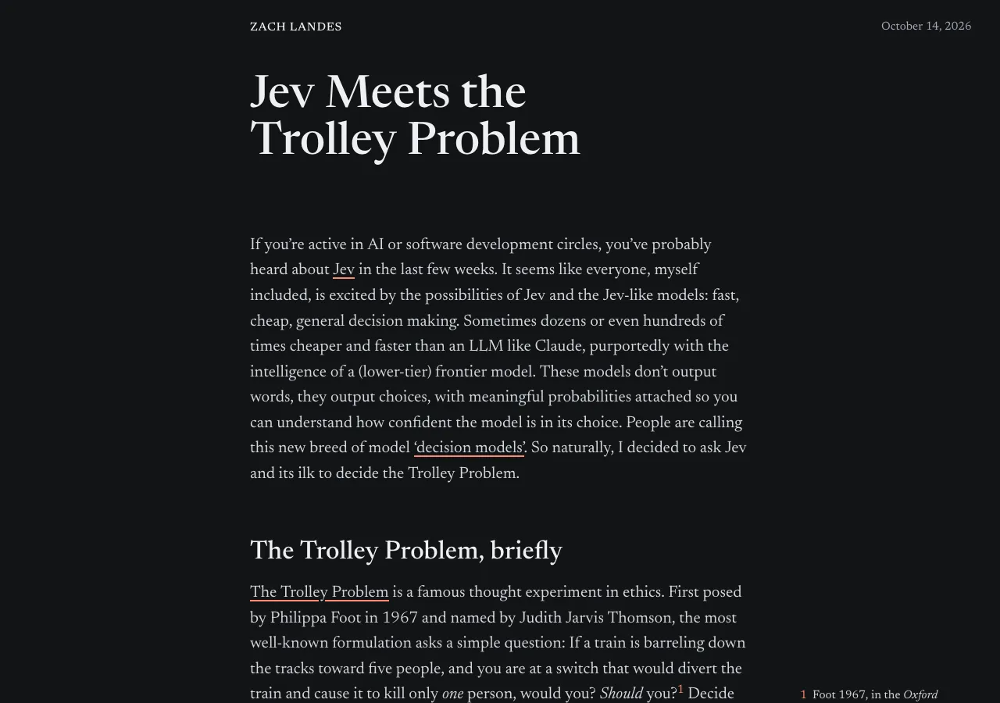

# Note markers on the sentences they support

Each of the trolley post's note markers now sits after the sentence its note backs up, instead of at the end of its paragraph.
Note 5 used to hold the prompt-sensitivity counts and the caveats on typed judgments, calibration and reasoning traces, and hung after the paragraph's last sentence, which neither part supports.
Its counts stay as note 5, on "as a person, you are not saving that server."
The caveats become note 6, on the sentence that starts "Despite Jev's lack of reasoning explanations".
Markers 1, 2 and 3 also moved earlier in their paragraphs; no prose or note wording changed.

The screenshots are from the post built with Jekyll 3.10 through a scratch Gemfile, since Jekyll doesn't run on this Mac's Ruby as-is, and taken with `chrome-devtools-axi` in headless Chrome and headless Firefox's `--screenshot`.

## 1280px, before and after

| Part of the page | Before | After |
| --- | --- | --- |
| What, me worry? (notes 5 and 6) |  |  |
| Notes 1 and 2 |  |  |

## Other widths

| 1279px | 390px phone | Firefox 1280px, note 1 |
| --- | --- | --- |
|  |  |  |

## Checks

In Chrome at 390, 1279, 1280, 1366 and 1920px:

- the page never scrolls sideways (`scrollWidth` equals the viewport)
- from 1280 all six notes are in the margin, each starting on its marker's line, with no margin item overlapping the one before it
- below 1280 the notes stay under their paragraphs, 5 then 6
- Appendix A's diorama question, which the long note 5 used to push about 200px down, no longer gets pushed
